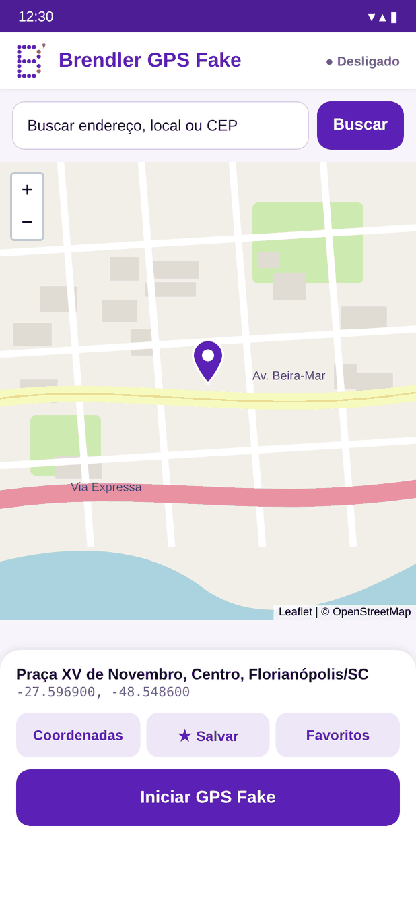
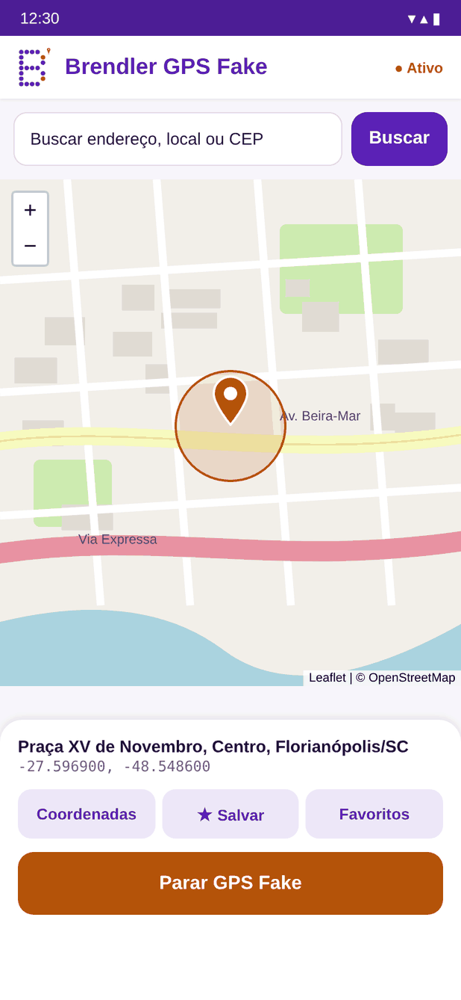
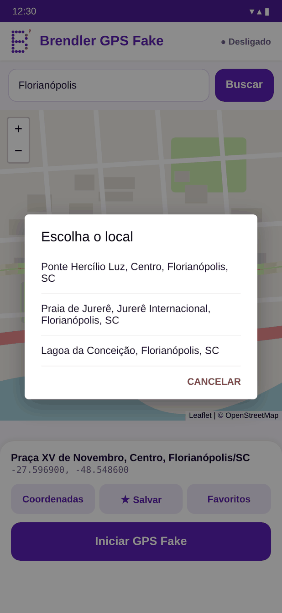
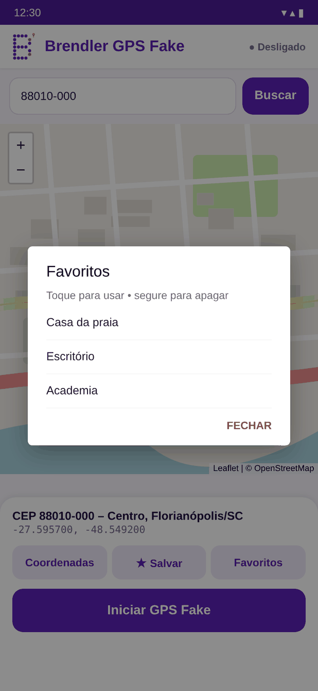

<p align="center">
  
</p>

<h1 align="center">Brendler GPS Fake</h1>

<p align="center">
  App Android simples para simular a localização GPS.<br>
  Mapa OpenStreetMap • busca por endereço, nome ou CEP • favoritos • funciona com Google Maps
</p>

<p align="center">
  
  
  
  
</p>

## Download

Baixe o **BrendlerGPSFake.apk** na página de [Releases](../../releases/latest).

Requer Android 6.0 ou mais novo.

## Recursos

- **Ponto fixo:** toque no mapa ou arraste o pino.
- **Busca:** aceita endereço, nome de lugar, CEP (`01310-100`) ou coordenadas (`-23.56, -46.65`).
- **Favoritos:** salve locais e use-os com um toque.
- **Funciona com Google Maps, WhatsApp e outros apps:** simula o GPS do Android e também o Google Play Services. Não é preciso desligar o Wi‑Fi nem a "Precisão de local do Google".
- **Notificação com botão Parar.** A localização continua sendo enviada mesmo com a tela desligada.
- **Gratuito e sem anúncios.** Usa só serviços abertos: OpenStreetMap, Nominatim e ViaCEP.

## Como usar

1. Instale o APK. Se o Android pedir, permita "Instalar apps desconhecidos".
2. Ative as **Opções do desenvolvedor**: Configurações › Sobre o telefone › toque 7 vezes em **Número da versão**.
3. Em **Opções do desenvolvedor**, toque em **Selecionar app de local fictício** e escolha **Brendler GPS Fake**.
4. Abra o app, escolha o local e toque em **Iniciar GPS Fake**.

O topo do app mostra a situação:
- **● Ativo:** a simulação está completa.
- **● Ativo (só GPS):** o Google Play Services não aceitou a simulação. Toque nesse texto para ver o motivo.

> Use com responsabilidade: para testes de apps, demonstrações e privacidade. Alguns apps e jogos proíbem localização simulada nos termos de uso.

## Compilar

### Android Studio

Abra a pasta do projeto. O Gradle baixa o `play-services-location` automaticamente.

### Linux, sem Gradle

O script `build.sh` monta o APK com aapt2, javac, dx e apksigner. Ele foi usado para gerar o APK da Release.

Antes de rodar, coloque em `third_party/jars/` os `.jar`, e em `third_party/res/` os recursos, destas bibliotecas:

- `play-services-location`
- `play-services-base`
- `play-services-basement`
- `play-services-tasks`
- `androidx.collection`

Elas não estão no repositório porque são bibliotecas do Google.

## Estrutura

```
app/src/main/
├── java/com/brendler/gpsfake/
│   ├── MainActivity.java         # tela, mapa, busca e favoritos
│   ├── MockLocationService.java  # serviço que envia a localização falsa
│   └── GeoSearch.java            # busca por nome (Nominatim), CEP (ViaCEP) e coordenadas
├── assets/map.html               # mapa Leaflet + OpenStreetMap
└── res/                          # layout, ícones e cores
```

---

Brendler© — contato: fabiobrendler@outlook.com
